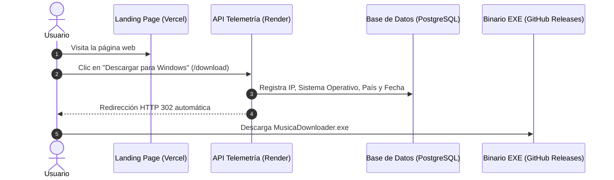

# Guía de Despliegue: Landing Page (Vercel) + Telemetría (Render) + Binario (GitHub Releases)

Esta arquitectura te permite tener un ecosistema 100% profesional, gratuito y escalable:
- **Vercel:** Aloja la Landing Page estática ultrarrápida (con CDN mundial gratuita).
- **Render:** Aloja la API de telemetría y base de datos (registra IPs, descargas y estadísticas).
- **GitHub Releases:** Aloja el archivo ejecutable `.EXE` (ancho de banda y almacenamiento gratuito ilimitado para descargas).

---

## 🏗 Flujo de Descarga y Métricas



---

## PASO 1: Subir los archivos .ZIP y .EXE a GitHub Releases

1. Crea un repositorio público en [GitHub](https://github.com/new), por ejemplo `MusicaDownloader`.
2. Sube tu código o simplemente ve a la sección **Releases** (a la derecha en la página de tu repositorio en GitHub).
3. Haz clic en **"Draft a new release"** (Crear nueva versión).
4. Elige un tag como `v1.2.0`, ponle un título (ej: `MusicaDownloader v1.2`) y arrastra ambos archivos de la carpeta `dist/`:
   - `MusicaDownloader-v1.2-Windows.zip` *(Recomendado: descarga limpia sin alertas de navegador)*
   - `MusicaDownloader.exe` *(Ejecutable directo)*
5. Publica la release (**Publish release**).
6. Copia los enlaces de descarga directa de ambos botones.
   Tendrán un formato como:
   - `https://github.com/cealfarias/MusicaDownloader/releases/latest/download/MusicaDownloader-v1.2-Windows.zip`
   - `https://github.com/cealfarias/MusicaDownloader/releases/latest/download/MusicaDownloader.exe`

---

## PASO 2: Desplegar el Backend de Telemetría en Render (Gratis)

1. Ve a [Render.com](https://render.com) e inicia sesión con tu cuenta de GitHub.
2. Haz clic en **New +** y selecciona **Web Service**.
3. Conecta el repositorio de GitHub donde subiste el proyecto (o la carpeta `telemetry-backend`).
4. Configura los parámetros:
   - **Root Directory:** `telemetry-backend` (si subiste todo el repositorio junto)
   - **Environment:** `Python 3`
   - **Build Command:** `pip install -r requirements.txt`
   - **Start Command:** `uvicorn main:app --host 0.0.0.0 --port $PORT`
   - **Plan:** Free
5. En la sección **Environment Variables** (Variables de Entorno), añade:
   - `ZIP_DOWNLOAD_URL`: La URL del archivo `.zip` en GitHub Releases obtenida en el Paso 1.
   - `EXE_DOWNLOAD_URL`: La URL del archivo `.exe` en GitHub Releases obtenida en el Paso 1.
6. (Opcional) Si deseas persistencia permanente con base de datos en Render, crea una **PostgreSQL Database** gratuita en Render y añade la variable `DATABASE_URL` a este servicio.
7. Haz clic en **Create Web Service**.
8. Una vez desplegado, Render te dará una URL (ej. `https://musica-telemetry.onrender.com`).
   - Puedes ver tus estadísticas en vivo entrando a:
     `https://musica-telemetry.onrender.com/stats`

---

## PASO 3: Desplegar la Landing Page en Vercel (Gratis)

1. En la carpeta [`landing-page/index.html`](file:///c:/MusicaDowloader/landing-page/index.html), abre el archivo y edita la línea 30:
   ```javascript
   const TELEMETRY_API_URL = "https://TU-SERVICIO-EN-RENDER.onrender.com";
   ```
   Pega allí la URL real que te dio Render en el Paso 2.
2. Ve a [Vercel.com](https://vercel.com) e inicia sesión con GitHub.
3. Haz clic en **Add New...** -> **Project**.
4. Importa tu repositorio.
5. Si subiste todo el proyecto junto, en **Root Directory** selecciona la carpeta `landing-page`.
6. Haz clic en **Deploy**.
7. ¡Listo! Vercel te dará tu dominio gratuito (ej: `https://musica-downloader.vercel.app`) o podrás conectar tu propio dominio personalizado `.com` si lo deseas.
