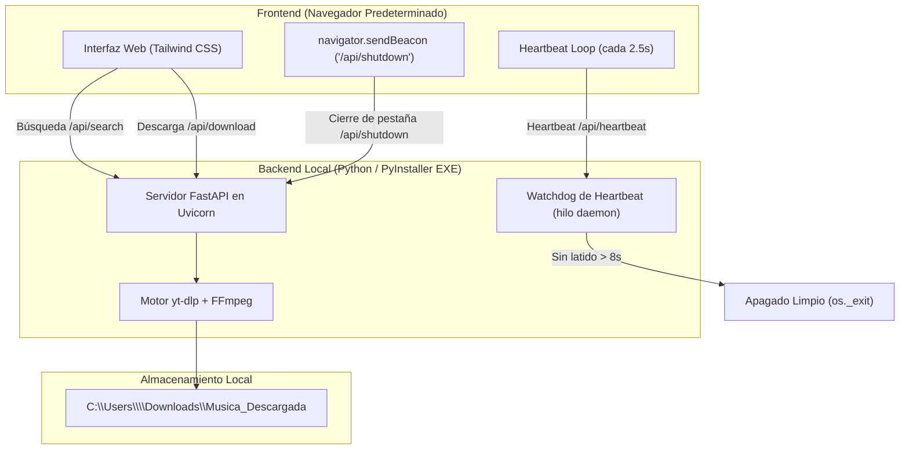

# Musica Downloader (MP3 Portable)

Aplicación de escritorio en Python para búsqueda y descarga directa de audio MP3 desde YouTube, diseñada para ejecutarse como un servidor FastAPI silencioso en segundo plano con interfaz web embebida y empaquetarse en un único archivo ejecutable portátil (`.exe`) para Windows.

---

## 🏗 Arquitectura del Sistema



---

## 🚀 Características Principales

1. **Modo Silencioso (`--noconsole`):**
   - No abre ventanas de consola terminal de Windows.
   - Inicia Uvicorn en un hilo en segundo plano (`daemon thread`) en `127.0.0.1:8765` (con resolución automática a puertos libres si está ocupado).
   - Abre de inmediato el navegador predeterminado del sistema.

2. **Gestión de Ciclo de Vida y Autocierre:**
   - Envío de latidos de vida (heartbeat) desde la UI cada 2.5 segundos.
   - Si el usuario cierra el navegador o pestaña, el watchdog detecta la desconexión tras 8 segundos y finaliza el proceso de fondo de manera ordenada (`os._exit(0)`).
   - Soporte adicional de `navigator.sendBeacon` en el evento `beforeunload` para apagado instantáneo.

3. **Ubicación Dinámica de Archivos:**
   - Carpeta predeterminada: `C:\Users\<Usuario_Actual>\Downloads\Musica_Descargada`.
   - **Selector de carpeta integrado:** Botón **"Cambiar Carpeta"** en la interfaz para seleccionar cualquier carpeta o disco de tu equipo mediante el diálogo nativo de Windows.
   - Botón directo para abrir la carpeta activa en el Explorador de archivos de Windows.

4. **Reproducción Previa en Directo:**
   - Haz clic sobre la miniatura o título de cualquier canción para abrir un reproductor modal y escuchar el video antes de descargarlo.
   - Botón de descarga directa desde el propio reproductor modal.

5. **Motor de Búsqueda y Conversión a MP3:**
   - Búsqueda ultrarrápida sin descarga previa mediante `yt_dlp` en modo `extract_flat=True`.
   - Conversión a MP3 con calidad alta mediante `FFmpegExtractAudio` (`preferredquality: '0'`).
   - Detección dinámica de `ffmpeg.exe`: prioritiza el binario empaquetado en PyInstaller (`sys._MEIPASS`), el PATH del sistema o la carpeta raíz.

---

## 🛠 Requisitos Previos

- Python 3.10 o superior (instalado con soporte de PATH).
- FFmpeg (incluido en el PATH o en la carpeta raíz al compilar).
- Dependencias de Python:
  ```bash
  pip install -r requirements.txt
  ```

---

## ▶️ Ejecución en Modo Desarrollo

Para probar la aplicación en modo desarrollo local:

```bash
python main.py
```

La aplicación iniciará el servidor en segundo plano y abrirá automáticamente tu navegador en `http://127.0.0.1:8765`.

---

## 📦 Compilación a Archivo Único (.EXE) Portable

Para compilar todo el proyecto en un único archivo ejecutable portátil:

### Opción 1: Mediante el script automatizado
```bash
python build_exe.py
```

### Opción 2: Doble clic en Windows
Ejecuta el archivo:
```bash
build.bat
```

### Opción 3: Comando directo de PyInstaller
```bash
pyinstaller --noconfirm --clean --onefile --noconsole ^
  --name "MusicaDownloader" ^
  --add-data "templates;templates" ^
  --add-binary "ffmpeg.exe;." ^
  main.py
```

El archivo ejecutable resultante se encontrará en:
`dist/MusicaDownloader.exe`
